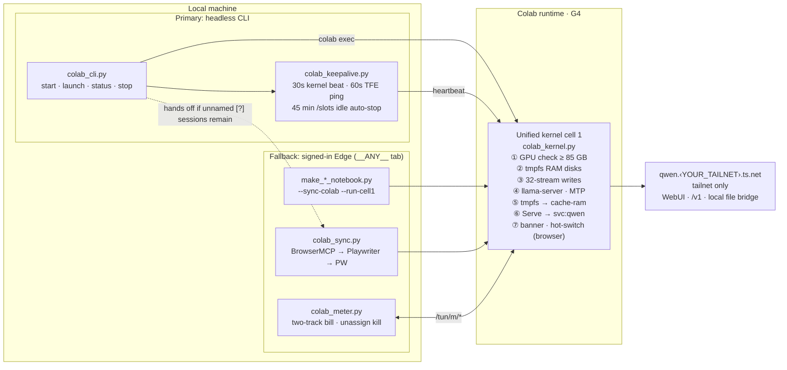

# colab-gpu-llm-service

[简体中文](README.md) | English

Run 100 GB-class GGUF models on a rented Google Colab G4 GPU (RTX PRO 6000 Blackwell, 96 GB VRAM): fast cold starts, headless keepalive, automatic release when idle, and a fixed private address over Tailscale.

The service is repeatable, private, and budget-aware. A single unified kernel (`scripts/colab_kernel.py`) powers **two coexisting tracks**:

- **Primary track (Headless Colab CLI + 30 s kernel heartbeat)** — `colab_cli.py` + `colab_keepalive.py` allocate a G4, run the kernel's startup code without opening a browser tab, keep the VM alive past Colab's 21–35 min CLI prune window via a 30 s `colab exec` heartbeat (ported from Wakeloom's local mode), and auto-stop after 45 idle minutes.
- **Fallback track (Browser notebook sync + zero-OAuth `/tun/m` meter & kill switch)** — `make_*_notebook.py --sync-colab --run-cell1`, `colab_sync.py` and `colab_meter.py` drive the same notebook inside a signed-in Edge tab (`BrowserMCP → Playwriter → playwright-cli`), provide an interactive WebUI/LoRA/hot-switch console, run archived multi-model notebooks, reconcile two-track CU bills, and force-kill unnamed `[?]` ghost sessions when `colab_cli.py stop --all` hands off to it.

The runtime is disposable and `/content` is wiped on every new session, so everything below is designed around fast, deterministic cold starts and around never paying for a GPU you are not using.

## What is in the box

| Piece | Problem it solves |
|---|---|
| **Primary:** Headless Colab CLI + 30 s kernel heartbeat (`colab_cli.py`, `colab_keepalive.py`) | Starts/stops G4 from the terminal with no browser tab; a 30 s `colab exec` heartbeat prevents CLI 0.7.5's 21–35 min idle reclamation, paired with a 45-min `/slots` idle auto-stop |
| Production fast-boot kernel & post-load `tmpfs` reclamation (`colab_kernel.py`) | `DEBUG_VERIFY = False` skips startup probes, polls `/health` every 0.5 s, warms up in the background, and frees GPU-only `/dev/shm` shard copies after load to grow `--cache-ram` to 16–64 GiB |
| DDR5 `tmpfs` RAM disk with 32-way direct writes | Colab's persistent disk caps writes at roughly 200-350 MiB/s; a 95 GB model would take minutes longer than it needs to |
| `MAP_POPULATE` zero-copy mapping of the PLE table | Removes a second memory copy and page faults during inference |
| `llama.cpp` MTP speculative decoding | Draft-head speculation tuned for code, tool calls and long-form writing |
| Tailscale Service (`svc:qwen`) + optional Pi tools bridge (`local_mcp.py` / `.mjs`) | A stable private endpoint plus native `read`, `write`, `edit`, and `bash`, protected by a dedicated Bearer token |
| **Fallback:** Browser-tab sync, zero-OAuth CU metering & ghost-session kill switch (`colab_sync.py`, `colab_meter.py`) | Pushes/runs notebooks in a signed-in browser tab, reads live balance/burn rate without OAuth, prints a two-track CU bill, and kills orphaned `[?]` sessions whose page was closed |
| Optional companion [Colab-yoga](https://github.com/incredible404-rgb/Colab-yoga) tray GPU manager (`colab_cli.py yoga`) | LLM service only (no video, image or ComfyUI): shows status and CU, extends the idle countdown, switches models, releases the runtime; shares the same G4 with this repo. `colab_kernel.py` exports the active models' headless cell 1 as its `colab_kernel_runners.json` |
| `.secrets.json` + `--sanitized` | Notebooks are generated from a private config; a sanitized build contains no real credential, tailnet or Drive ID |

## Architecture



## Fast cold start

1. **Skip the persistent-disk write wall.** The notebook grows `/dev/shm` and `/var/colab` and symlinks them back to the runtime directory. Weights land in physical RAM, so there is no disk I/O on the hot path.
2. **32 concurrent streams.** A separate downloader runs 8 processes x 4 threads, each writing with `os.pwrite` at its own offset. Separate processes avoid the single-process GIL and TLS decryption bottleneck. Signed CDN links are resolved once and reused.
3. **`MAP_POPULATE` for the largest tensor.** The second shard is a single 26.8 GiB per-layer embedding table. It is written to `/dev/shm` first and `llama-server` maps it with `--lazy-mode off`, pre-populating the page tables. Inference then runs without page faults and without a second copy.
4. **One-cell console.** After startup the first cell shows a ready banner with the WebUI link and a stop button that releases the GPU.

## Speculative decoding and sampling

`llama.cpp` runs `--spec-type draft-mtp` with a matching MTP draft head. The G4 notebook is tuned for code and long-horizon agent work: single 262,144-token slot, each model card's recommended sampling (no extra penalties or DRY), a 16 GiB prompt cache with slot persistence, and a 65,536-token output limit. Treat the exact numbers as a starting point and re-measure with your own prompts: run one cold request and two consecutive ones, and read `predicted_per_second` and the draft acceptance rate from the server log.

## Private access with Tailscale Service

The runtime joins your tailnet with a one-shot, ephemeral, `tag:colab` auth key minted from an OAuth client, then advertises `svc:qwen`. With `autoApprovers.services` in the ACL, no one has to log in or click Approve. The address stays `qwen.<YOUR_TAILNET>.ts.net` across runtimes. See [`references/tailscale-serve.md`](references/tailscale-serve.md) for the ACL snippet and the two classic failure modes (an interrupted cell kills the daemon; a missing `--statedir` breaks HTTPS).

The service is only visible inside your tailnet, so the WebUI works without pasting a key. If you ever expose it through Funnel or any public endpoint, add `--api-key-file` first.

## Primary track: Headless start with the official Colab CLI + 30 s kernel heartbeat

As of CLI 0.7.5, a CLI-created runtime (T4 or G4) is reclaimed 21-35 minutes after creation unless the kernel sees fresh executions; TFE pings, one long-running cell and ongoing inference do not count, and the legacy `RuntimeService/KeepAliveAssignment` RPC returns `403 USER_PROJECT_DENIED`. A one-line `colab exec` every 30 s keeps the VM alive (the pattern Wakeloom's local mode uses). `colab_keepalive.py` runs that execution itself the same way (a fresh kernel websocket per beat: connect, execute, close) instead of starting a CLI process every 30 s; an in-process failure is covered at once by a `colab exec` beat, and `COLAB_KEEPALIVE_BEAT=exec` reverts entirely. Tested 2026-11-10 on a CPU runtime: 37 min, 75 in-process beats, 0 failures, never reclaimed; the daemon averaged about 76 ms of CPU per beat (the CLI beat took about 1.1 s). Tested 2026-11-07: the T4 control arm was pruned at 21.0 min while the heartbeat arm lived the full 42 min; a G4 running `qwen38-fn` served requests and lived 39 min across 77 heartbeats (1 expected queue timeout while cell 1 was running, 0 post-startup failures) until the idle guard stopped it cleanly.

`scripts/colab_cli.py` drives the official [`google-colab-cli`](https://github.com/googlecolab/google-colab-cli) (`uv tool install "google-colab-cli==0.7.5"`; the first OAuth authorization has to be done by a person at a terminal, see Prerequisites below). It runs the exact same cell-1 code generated by `colab_kernel.py` (any active or archived model listed by `colab_kernel.py --list`) with the frontend-only tail (banner, WebUI popup, stop button) stripped off. No browser tab is needed.

CLI 0.7 dropped its keep-alive daemon. `start` and `launch` spawn `scripts/colab_keepalive.py` detached under the CLI's own interpreter: it runs the kernel heartbeat every 30 s, also pings `GET /tun/m/<endpoint>/keep-alive/` (header `X-Colab-Tunnel: Google`) every 60 s, polls `/slots` over Tailscale and runs `colab stop` after `--idle-min` (default 45) minutes without inference. If the PC sleeps, the heartbeat stops and Colab reclaims the VM on its own within ~20 min.

```bash
python -X utf8 scripts/colab_cli.py start  [<slug>]    # G4 session -> cell 1 -> Tailscale /v1/models check -> verify cell
python -X utf8 scripts/colab_cli.py launch [<slug>]    # detached cell-1 launch (LAUNCH_DETACHED=1) -> poll /health
python -X utf8 scripts/colab_cli.py status                # balance, burn rate, sessions, heartbeat & idle-guard state
python -X utf8 scripts/colab_cli.py stop   --all          # release all + auto-fallback to colab_sync --release-all if needed
```

- **Model slugs:** active `qwen38-huihui-v2` (default), `gemma4-31b`, `qwen38-27b-rvn`, `glm53-flash`; archived ones such as `qwen38-fn` and `qwen38-fn-nl` start by slug too. `python -X utf8 scripts/colab_kernel.py --list` is the source of truth.
- **Automatic fallback on stop:** If `colab sessions` shows an unnamed `[?]` assignment (for example, a session started from a browser tab or an orphaned CLI assignment), `colab_cli.py stop --all` (only that form escalates to releasing the whole account; after stopping one name, `stop <slug>` releases only the assignments that showed as `[?]` in two listings in a row, one endpoint at a time, and verifies; it never touches a session that has a local name, Colab-yoga's included, and never calls `stop_all`) works through these in order of cost: (1) when Colab-yoga is installed, its bridge `stop_all` (official unassign per endpoint, no browser needed); (2) if anything is left, `colab_sync.py --release-all` from the fallback track, which force-releases via `/tun/m/unassign` and verifies `0 active / 0.00 CU/h` (needs a browser driver); (3) otherwise it prints a hint to end the sessions by hand in Colab's web UI (Runtime, Manage sessions).
- CLI sessions cannot read Colab Secrets or mount Drive; the kernel downloads from pinned Hugging Face revisions and forwards a local `HF_TOKEN` when present; the 4 active models use public weights and need no `HF_TOKEN`. G4 rejects `--high-mem`, and `colab exec` times out after 30 s unless `--timeout` is passed; the script handles both.

## Fallback track: Browser-tab sync, zero-OAuth CU metering and ghost-session kill

Keep the browser workflow as a ready backup when:
1. You want the interactive cell-1 console (one-click LoRA toggle, stop button) or cell-2 **in-runtime hot switch** without releasing the G4 VM;
2. You are running an archived model (`qwen35-122b`, `nemotron-120b`, ...; declared in `scripts/archived_models.py` and generated by name on the latest kernel);
3. The CLI OAuth token is expired/unconfigured and you want zero-OAuth operation inside an already signed-in Edge tab (`BrowserMCP → Playwriter → playwright-cli`);
4. You need the two-track CU bill or need to sweep `[?]` ghost sessions that the CLI cannot address by name.

Colab's own web app talks to `/tun/m/*`. The scripts call those endpoints from inside a signed-in `colab.research.google.com` tab, so no OAuth client or API key is needed.

The browser driver itself is optional and not shipped here; install one when you need it: Playwriter (`npm install -g playwriter`, plus its Chrome Web Store extension in Edge) or `@playwright/cli` (`npm install -g @playwright/cli`). Both need Node.js and an Edge signed in to Google. You can also bring your own BrowserMCP bridge script and point `COLAB_BROWSERMCP_BRIDGE` (or `browsermcp_bridge` in `.secrets.json`) at it. The primary track works without any of this; for an urgent stop use the Colab-yoga bridge or the Colab web UI first instead of waiting on a browser driver.

```bash
python -X utf8 scripts/colab_meter.py status
# Active assignments: 0 | Burn rate: 0.00 CU/h | Balance: <your balance> CU | Eligible GPUs: H100, G4, A100, L4, T4   (illustrative output)

python -X utf8 scripts/colab_meter.py start -s g4 -g G4     # record opening balance and time
python -X utf8 scripts/colab_meter.py stop  -s g4           # kill, verify, print the two-track bill
python -X utf8 scripts/colab_meter.py stop  --all           # clear every active assignment

python -X utf8 scripts/colab_sync.py --status               # same read, no meter state needed
python -X utf8 scripts/colab_sync.py --release-all          # kill all and verify
```

**Tab hygiene.** With drive id `__ANY__`, an already open Colab tab is reused untouched (never reloaded or navigated). If none is open, a temporary tab is opened in the background and closed immediately after the call.

**Kill handshake.** For each active `endpoint`: `GET /tun/m/unassign/<endpoint>` returns a `token`; `POST` to the same URL with `X-Goog-Colab-Token: <token>` releases it. After 1.5 s the script re-queries `ccu-info` and `assignments`, up to 3 times, until `assignmentsCount == 0` and `consumptionRateHourly == 0`. This also clears ghost sessions whose notebook page was closed before `runtime.unassign()` could run.

**Two-track bill.**

```text
track 1 (account ledger delta)  max(0, start_balance - end_balance)
track 2 (wall clock)            duration_seconds / 3600 x rate_hourly
```

Track 1 is an account-wide balance delta: it lags a few minutes behind real consumption, includes every instance that ran in the window, and can even rise on a top-up or refund (it is clamped to 0 and a note is printed). Track 2 is per session. Showing both makes a stuck session obvious; with concurrent instances read track 2 as the per-session figure.

**Safe stop.** `colab_meter.py stop -s NAME` only releases the endpoints recorded for that session. An unknown name, or a session without bound endpoints, exits with 1 and releases nothing; use `--all` to force-release every active instance. A session recorded by `--run-cell1` while the VM was still allocating (rate 0, no endpoints) is backfilled with the real endpoint and burn rate by the next `status` or `stop`.

**Sync integration.** `make_*_notebook.py --sync-colab --run-cell1` records the opening balance once cell 1 starts. `--release-runtime` also calls `unassignCurrentVm`, sweeps leftover assignments, verifies `0 active / 0.00 CU/h` and prints the bill.

The `/tun/m` endpoints are undocumented and may change. Treat them as a convenience, and keep the Colab "Manage sessions" page as the ground truth if the two ever disagree.

## Quick start

### Prerequisites

| Item | Requirement |
|---|---|
| Paid Colab quota | A Colab Pro / Pro+ / Ultra plan or pay-as-you-go compute units (CU), with G4 selectable on the account; the free tier does not work. Rates and quotas change, see [`references/cu-budget.md`](references/cu-budget.md) |
| Host | Windows 10/11 or macOS (Apple Silicon `arm64`), Python 3.10+ (this repo's scripts; the Colab CLI needs 3.12, see next row), Git; `pip install requests` (everything else is standard library). Keep-alive daemons use breakaway / scheduled tasks and `taskkill` on Windows, and `start_new_session` (`setsid`) + `SIGTERM` on macOS/POSIX |
| Official Colab CLI | `google-colab-cli` needs Python ≥ 3.12: `uv tool install` downloads and manages that Python itself (independent of the host Python), or reuse the Python bundled with Colab-yoga. An agent can run this as is (no terminal restart): `python -m pip install uv`, then `python -m uv tool install "google-colab-cli==0.7.5"`; `python -m uv tool dir --bin` prints the folder holding `colab`, and a PATH-independent call is `"$(python -m uv tool dir --bin)/colab" --version`. The scripts in this repo look for `colab` in `~/.local/bin` and uv's bin directory when it is not on PATH; `python -m uv tool update-shell` (and reopening that terminal) is only needed to type `colab` in a person's own terminal. The keep-alive design follows 0.7.5's reclamation behavior, so pin this version |
| First OAuth authorization | Done by **a person in their own terminal**: run `colab sessions`, open the printed link, paste the authorization code back (it waits on `input()`; the scripts here close stdin when they call `colab`, so an unauthorized CLI fails at once with a one-line message that carries the link instead of hanging). Or use the Colab-yoga bridge in two steps: `runtime\python.exe -u bridge\colab_yoga_bridge.py auth_url` (Git Bash: `"$LOCALAPPDATA/Programs/Colab-yoga/runtime/python.exe" -u "$LOCALAPPDATA/Programs/Colab-yoga/bridge/colab_yoga_bridge.py" auth_url`) for the link, then `... auth_code <code>` after authorizing. Both share `~/.config/colab-cli/token.json` |
| Tailscale | Local client >= 1.78, signed in; the `svc:qwen` Service, the `tag:colab` tag and an OAuth client created in your tailnet, with **MagicDNS** and **HTTPS Certificates** switched on in the DNS settings, see [`references/tailscale-serve.md`](references/tailscale-serve.md) |
| Optional: Colab-yoga | The companion Windows tray / macOS menu bar GPU manager ([Colab-yoga](https://github.com/incredible404-rgb/Colab-yoga); LLM service only, no video, image or ComfyUI) installed to `%LOCALAPPDATA%\Programs\Colab-yoga` (`~/Library/Application Support/Programs/Colab-yoga` on macOS), or the portable build unzipped anywhere; it shares the same G4 with this repo (runners are written to `%LOCALAPPDATA%\Colab-yoga` or `~/Library/Application Support/Colab-yoga` automatically, no setup). No core command depends on it |
| Optional: fallback track | Node.js, an Edge signed in to Google, and one browser driver: Playwriter (`npm install -g playwriter` + its Edge extension) or `@playwright/cli` (`npm install -g @playwright/cli`), or your own BrowserMCP bridge (`COLAB_BROWSERMCP_BRIDGE`) |

**Cost:** a G4 burns about **10 CU/hour** (both 2026-11-07 starts showed `rate 10.05 CU/h`; the Colab page and `colab_cli.py status` are authoritative for today's number). A cold start measured 2-2.5 minutes, longer for bigger weights, and it is billed too; two hours of use is roughly 20-25 CU. The keep-alive process stops the runtime after 45 minutes without inference traffic.

### Install as an agent skill

The repository ships a `SKILL.md` (with `name` and a trigger description in its frontmatter), so cloning the whole repo into an agent's skills directory is enough:

```bash
# Claude Code
git clone https://github.com/incredible404-rgb/colab-gpu-llm-service.git ~/.claude/skills/colab-gpu-llm-service
# other agents that read ~/.agents/skills
git clone https://github.com/incredible404-rgb/colab-gpu-llm-service.git ~/.agents/skills/colab-gpu-llm-service
```

Then finish the setup in that directory as described under "From clone to first boot". A skills directory can be reinstalled or updated over, so prefer environment variables over `.secrets.json` for the keys (`LLAMA_API_KEY`, `TS_CLIENT_ID`, `TS_CLIENT_SECRET`, `TAILNET_FQDN`, see the tables below; set them as user-level variables; the keep-alive daemon reads config through the same loader as `start`, and an untouched `<YOUR_...>` placeholder in `.secrets.json` yields to the environment variable); `.secrets.json` is only read from the repository root, keeping it elsewhere is not supported. Division of labour: new instance or new model -> this repo's `start`; switching between already exported models, extending, viewing, releasing -> the Colab-yoga tray (its agent skill lives in the Colab-yoga repo under `skills/colab-yoga` and has to be installed separately; every active model is built for a G4, about 96 GB of VRAM).

### From clone to first boot

```bash
git clone https://github.com/incredible404-rgb/colab-gpu-llm-service.git
cd colab-gpu-llm-service
pip install requests
cp .secrets.example.json .secrets.json          # fill in per the table below; the file is git-ignored

python -X utf8 scripts/colab_kernel.py --list  # active/archived model slugs; start without a slug uses the first active one
python -X utf8 scripts/colab_cli.py status      # read-only check: CLI authorized, CU balance readable, no GPU allocated
python -X utf8 scripts/colab_cli.py start > start.log 2>&1 &   # in the background: G4 session -> cell 1 -> Tailscale /v1/models check -> verify cell
python -X utf8 scripts/colab_cli.py stop --all  # release right after use; check the last line shows 0 active / 0.00 CU/h
```

`start` allocates the instance and downloads 100 GB-class weights, so it can block from minutes up to an hour: **do not wait for it in the foreground** (an agent tool call times out first). Run it in the background (`&` in Git Bash, `Start-Process` in PowerShell, or the agent tool's background mode) and watch the log for `[colab_cli] start OK` or `start FAILED`. If the four required fields are empty or still the `<YOUR_...>` placeholders from the example file, `start` exits before allocating anything and burns no CU; on failure the script releases the instance it created, but still verify `0 active` with `status`.

A successful `start` prints `[colab_cli] start OK in <seconds>s`; afterwards `http://qwen.<YOUR_TAILNET>.ts.net:443/v1` is the OpenAI-compatible endpoint (requests carry `Authorization: Bearer <api_key>`, but the server does not check it, see the `api_key` row below) and the root path is the WebUI, both visible only inside your tailnet. Before `colab new`, `start` / `launch` run a local preflight (the colab CLI's `pythonw.exe`, Tailscale online on this PC, Tailscale OAuth credentials that can mint a token); if one fails they say why and exit without allocating, and `--skip-preflight` overrides it. `status` cannot show the burn rate before boot (0 with no active instance): quote about 10 CU/h in the confirmation, then read `rate` from the `start OK` line.

### `.secrets.json` fields

The first four are required by `start`; a missing one (or one that is still a `<YOUR_...>` placeholder from the example file) fails fast, before any GPU is allocated, with `missing ... in .secrets.json / environment`.

| Field | Meaning |
|---|---|
| `api_key` | A client-side key written to the runtime for `/v1` calls. llama-server starts without `--api-key` / `--api-key-file`, so API and WebUI access are gated by the tailnet rather than this value. Local MCP checks a separate dedicated Bearer token; the API key does not grant local tool access. See [`references/secure-remote-service.md`](references/secure-remote-service.md) for API access control |
| `ts_client_id`, `ts_client_secret` | Tailscale OAuth client credentials (Auth Keys: Write only, tag `tag:colab`) used to mint one-shot ephemeral auth keys at runtime |
| `tailnet_fqdn` | Service address, `qwen.<YOUR_TAILNET>.ts.net`; its first label is the Service name you created (default `qwen`) |
| `service_name` | Optional, default `qwen`. The runtime publishes the Tailscale Service `svc:<service_name>`; when you rename it, the Service you created in Tailscale, the `svc:...` in the ACL and the first label of `tailnet_fqdn` must all match, otherwise generating the notebook fails before any weights are downloaded |
| `local_tailscale_ip` | Optional, MCP only. Tailscale IP of the PC running `local_mcp`. Unset means no tunnel, no `local_mcp` WebUI default entry, and `start` does not launch the local bridge |
| `*_drive_id` (one per active model) | Optional. Drive file ID of that model's notebook, needed only for `--sync-colab`; `colab_kernel.py` resolves and writes it back from the local Drive client database when generating |
| `webui_system_prompt` | Optional. Default system prompt written into the WebUI config; empty (none) by default |
| `notebooks_dir` | Optional. Drive "Colab Notebooks" folder that private notebooks are additionally mirrored into; no mirroring by default |
| `magpie_provider` | Optional. Id of the Magpie provider that `--sync-magpie` keeps in step with the active models; `--sync-magpie` is skipped with a hint when unset |
| `browsermcp_bridge` | Optional. Path of a BrowserMCP bridge script, the first browser-driver tier of the fallback track; unset means Playwriter / playwright-cli directly |

The `<YOUR_...>` values in the example file are placeholders, not usable values; the optional keys (`service_name` and after) are not in the example file, add them when needed; an optional key written as `""` counts as unset. Each field can also come from an environment variable: `LLAMA_API_KEY`, `TS_CLIENT_ID`, `TS_CLIENT_SECRET`, `TAILNET_FQDN`, `LOCAL_TAILSCALE_IP`, plus `G4HUIHUI_DRIVE_ID`, `GEMMA31B_DRIVE_ID`, `RVN27B_DRIVE_ID`, `GLM53_DRIVE_ID`, `WEBUI_SYSTEM_PROMPT`, `COLAB_NOTEBOOKS_DIR`, `MAGPIE_PROVIDER`, `COLAB_BROWSERMCP_BRIDGE`. Resolution order is `.secrets.json`, then environment, then a placeholder (empty for optional settings). Other tunables:

| Variable | Effect |
|---|---|
| `COLAB_YOGA_DIR` | Optional. Colab-yoga directory: runners and `local_mcp_bridge.json` are written there (created if missing), and `colab_cli.py yoga` uses it. Unset, runners go to `%LOCALAPPDATA%\Colab-yoga`, and `colab_cli.py yoga` tries the `appDir` in `%LOCALAPPDATA%\Colab-yoga\install.json`, then `%LOCALAPPDATA%\Programs\Colab-yoga` |
| `DRIVEFS_DB` | Path of the Drive client metadata database |
| `PLAYWRITER_ENTRY` | Path of Playwriter's `dist/index.js`; default is the global npm prefix |
| `HF_TOKEN` | Optional. Hugging Face token forwarded to the runtime; the 4 active models use public weights and do not need it, only gated or rate-limited models do |
| `COLAB_KEEPALIVE_BEAT` | `exec` makes each heartbeat start `colab exec` again (default: run in the daemon, falling back on failure) |

### Command cheat sheet

```bash
python -X utf8 scripts/colab_cli.py start  [<slug>] [--gpu G4] [--idle-min 45] [--no-verify] [--keep-on-fail] [--skip-preflight]   # run in the background
python -X utf8 scripts/colab_cli.py launch [<slug>] [--skip-preflight]   # detached start (reads the private build in notebooks/private/, else notebooks/; generate it first with colab_kernel.py <slug>)
python -X utf8 scripts/colab_cli.py verify [<slug>]       # rerun the verify cell only
python -X utf8 scripts/colab_cli.py status                # balance, burn rate, sessions, heartbeat & idle-guard state
python -X utf8 scripts/colab_cli.py stop <slug>           # stop that session and release leftover [?] assignments (no local name) by endpoint; named sessions are left alone
python -X utf8 scripts/colab_cli.py stop --all            # release every assignment on the account; for unnamed [?] sessions tries the Colab-yoga bridge first, then colab_sync
python -X utf8 scripts/colab_cli.py yoga [gui | wake | status | stop]   # optional Colab-yoga interop (old name easycolab still works)

python -X utf8 scripts/colab_kernel.py --list             # active and archived models
python -X utf8 scripts/colab_kernel.py --probe-hf <repo> [rev]   # HF pre-flight for a new model
python -X utf8 scripts/colab_kernel.py --all [--mirror-drive]    # generate every active notebook and export the Colab-yoga runners
python -X utf8 scripts/colab_meter.py status              # fallback track: cloud ledger + current assignments
python -X utf8 scripts/colab_meter.py stop --all          # fallback track: kill and print the two-track bill

cd scripts && python -X utf8 -m unittest discover -p "test_*.py"   # all unit tests
```

Fallback track (browser sync): `python -X utf8 scripts/make_g4_huihui_v2_notebook.py --sync-colab --run-cell1`, then `python -X utf8 scripts/colab_meter.py stop --all` to release and settle.

### Optional: Colab-yoga tray manager

[Colab-yoga](https://github.com/incredible404-rgb/Colab-yoga) is the companion Windows tray GPU manager. It manages the LLM service only (llama-server :8081, the Web UI, Magpie and the MCP file bridge; no video, image or ComfyUI), and chat traffic never passes through it. What it manages is the GPU: how much CU was spent, which model is running, whether each way in works, and that the runtime stays alive only as long as it is used. Waking it never kills the `llama-server` on `:8081` or the MCP forwarder; it only replaces its own older server process. It installs to `%LOCALAPPDATA%\Programs\Colab-yoga` (`Colab-yoga.exe`, `runtime\python.exe`, `bridge\colab_yoga_bridge.py`).

Division of labour: new instance or new model -> this repo's `colab_cli.py start`; switching between already exported models, extending, viewing, releasing -> the Colab-yoga tray. Its agent skill is in the Colab-yoga repo under `skills/colab-yoga` and needs a separate install; every active model is built for a G4 (about 96 GB of VRAM). Running `colab_cli.py start` first and waking Colab-yoga afterwards, or the other way round, reuses the same G4 through `~/.config/colab-cli/sessions.json`. When `start` reuses somebody else's session (Colab-yoga's, say), a failure is reported and that session is left running; `yoga wake` counts as successful only when the bridge output contains a `WAKE_URL:` line, otherwise no keep-alive is started. The heartbeat also reads Colab-yoga's `/health` inside the VM: a download or VRAM load in progress, or an idle countdown that was extended, counts as activity and postpones this repo's idle stop.

**Make Colab-yoga see this repo's models (runners, three fixed steps):**

1. Install Colab-yoga to `%LOCALAPPDATA%\Programs\Colab-yoga`, or unzip the portable build anywhere; no environment variable is needed either way: runners go to Colab-yoga's per-user data folder `%LOCALAPPDATA%\Colab-yoga` (created if missing), and an older copy already in `%LOCALAPPDATA%\Programs\Colab-yoga` or in the `appDir` of `install.json` is refreshed too. The same folder gets `local_mcp_bridge.json` with the absolute path of this clone's `scripts/local_mcp.py`. Set `COLAB_YOGA_DIR` only to put them elsewhere (it wins).
2. Run `python -X utf8 scripts/colab_kernel.py --all`; the output must contain a line `Exported Colab-yoga runners to: <path>`. `skipped exporting runners` means neither `LOCALAPPDATA` nor `COLAB_YOGA_DIR` is set and the install folder does not exist; `Refused to export Colab-yoga runners: missing ...` (exit code 1) means one of the four required values is unset, fix `.secrets.json` / the environment first, no runners with placeholders are written.
3. Re-run step 2 after editing `.secrets.json` (keys, tailnet, file-bridge IP, system prompt): the values inside the runners were baked in when it was generated. `colab_kernel_runners.json` holds real keys, never commit it.

`colab_cli.py yoga ...` reports the expected install location when it cannot find the app, and `COLAB_YOGA_DIR` points it at a custom directory.

### Troubleshooting

| Symptom | Fix |
|---|---|
| `missing ... in .secrets.json / environment` | The four required fields are empty or still the `<YOUR_...>` placeholders from the example file; fill them in per the table above. This check runs before any GPU is allocated |
| `colab CLI not found` / `colab` is not recognized | The scripts already look in `~/.local/bin` and `uv tool dir --bin`; if this still shows, it is not installed: `python -m pip install uv && python -m uv tool install "google-colab-cli==0.7.5"`, no terminal restart needed |
| `colab CLI is not authorized ...` | Not authorized, or the token expired (the scripts close stdin, so it fails at once instead of hanging). Give the link in the message to a person, who runs `colab sessions` in their own terminal, or use the Colab-yoga bridge `auth_url` / `auth_code` two steps; an agent should not wait on input itself |
| `preflight failed, nothing was allocated` | The local pre-boot check failed: fix the listed items (the CLI's `pythonw.exe`, Tailscale online on this PC, Tailscale OAuth credentials); add `--skip-preflight` only when you know better |
| `UnicodeEncodeError` | The console is not UTF-8: always run `python -X utf8 scripts/...` (the entry points also force UTF-8 now); `start` releases the instance it created on any unexpected error after allocation, but still verify with `status` |
| `Colab-yoga not found at ...` | The optional component is not installed: install Colab-yoga as the message says, or set `COLAB_YOGA_DIR`; core commands are unaffected |
| `skipped exporting runners` | Neither `LOCALAPPDATA` nor `COLAB_YOGA_DIR` is set and the default install folder does not exist; redo the three runners steps above until `Exported Colab-yoga runners to:` appears |
| `Backend rejected accelerator` | G4 has a single shape, so `--high-mem` is rejected (the script skips it); or the account has no G4 quota or no free card right now |
| Instance vanishes after 20-35 minutes | The heartbeat process is not running (PC slept or it was killed); check with `status`, `start`/`launch` is what spawns it |
| Still active or `[?]` after `stop --all` | In order: (1) the Colab-yoga bridge `stop_all` (`stop --all` already tries it; by hand: `runtime\python.exe -u bridge\colab_yoga_bridge.py stop_all`); (2) end the sessions by hand in Colab's web UI (Runtime, Manage sessions); (3) the browser driver `python -X utf8 scripts/colab_sync.py --release-all` (install Playwriter or similar first, see the fallback track). Verify with `status` |
| Domain times out | A fresh Service approval takes a few to ten-odd seconds, retry; confirm Tailscale >= 1.78, MagicDNS and HTTPS Certificates are on in the DNS settings, and `autoApprovers.services` is in the ACL |
| WebUI MCP connection fails | Start the PC bridge with `python -X utf8 scripts/local_mcp.py start` or the Colab-yoga MCP card. A 401 means the private client Bearer header is missing or wrong. A port conflict names the other service and leaves it running |

The full runbook, including how to onboard a model, is in [`SKILL.md`](SKILL.md) section 7 onward.

The notebooks committed to the public repository under `notebooks/` are **sanitized builds** (placeholders only). Running `make_*_notebook.py` or `colab_kernel.py` locally writes your private build to `notebooks/private/`, which `.gitignore` excludes, so the committed sanitized files are not overwritten (a skills directory is a `git clone`, and overwriting them would block a later `git pull`); `--sanitized` writes to `notebooks/`, `--output-dir` moves either. Before pushing to a public remote, still check `git status` to make sure no private build is staged.

### Sanitized builds

```bash
python -X utf8 scripts/make_g4_huihui_v2_notebook.py --sanitized --output-dir dist/
```

`--sanitized` fills every sensitive field with a placeholder and ignores `.secrets.json` and the environment. It refuses to combine with `--sync-colab`, so a placeholder notebook can never be pushed to Colab.

## Local tools bridge (local_mcp)

The bridge calls the installed Pi's `createCodingTools(cwd)` directly for native `read`, `write`, `edit`, and `bash`. Partial reads, image attachments, truncation, exact multi-edits, command timeouts, and argument coercion use Pi's implementations. Tools run with the logged-in user's permissions; cwd is a default, not a sandbox. Pi session skills, rules, and approval hooks are not loaded automatically.

Install Node.js as required by Pi and Pi itself (`npm i -g @earendil-works/pi-coding-agent`), then run locally:

```bash
python -X utf8 scripts/local_mcp.py start
python -X utf8 scripts/local_mcp.py status
python -X utf8 scripts/local_mcp.py stop
```

First start creates `~/.config/colab-cli/local-mcp.json` with a dedicated random token and `cwd`; existing choices are preserved. Initial cwd comes from `LOCAL_MCP_CWD`, else `~/Documents`. Restart after editing the config. Logs go to neighboring `local-mcp.log`, without tokens or command bodies; a log over 1 MB is cut to its last 256 KB before a start.

`start` first checks for Node.js and the global `@earendil-works/pi-coding-agent` (`npm i -g`) and exits with the reason, writing no config, when either is missing. By default it listens on `127.0.0.1:3426` only; with a valid `local_tailscale_ip` it also listens on `<local_tailscale_ip>:3426` for the cloud tunnel (an unavailable address is retried every 15 seconds while loopback stays available). It does not bind `0.0.0.0` by default. An explicit `LOCAL_MCP_HOST` or `start --host <address>` binds exactly that address; pass the same `--host` to subsequent `status` and `stop` commands, or retain the same environment variable for each command. `colab_cli.py start` launches the local bridge only when `local_tailscale_ip` is set (or `COLAB_LOCAL_MCP_AUTO=1`).

With `local_tailscale_ip` configured, generated WebUI defaults contain a `local_mcp` entry at `http://127.0.0.1:3426/mcp` using the cloud proxy. Once per browser, add `Authorization: Bearer <token from local-mcp.json>` in the client's private MCP settings. The browser retains it. Real tokens never enter notebooks, runners, or anonymous `/props` defaults, and are separate from llama-server's `api_key`.

The cloud-to-PC link is encrypted by Tailscale. Missing or wrong tokens receive 401 on `/mcp`; anonymous `/health` reveals only identity. Startup waits for readiness and reuses one instance across repeated or concurrent requests. Stop verifies authentication and PID, leaving unrelated port holders alone.

Colab CLI starts the bridge with keepalive. [Colab-yoga v0.5.0+](https://github.com/incredible404-rgb/Colab-yoga) starts it on wake, checks and recovers it every 60 seconds during an active session, and offers a manual **Start** button that does not wake a GPU. Automatic shutdown requires confirmation that the account has no active assignments; failed account checks leave the shared bridge running.

Updating scripts does not replace an already running bridge process. After upgrading, finish any active tool call, then run `stop` followed by `start` once to apply the listener changes. No GPU or model restart is needed.


Isolated checks use temporary files and a free port without allocating a GPU:

```bash
cd scripts
python -X utf8 -m unittest discover -p 'test_*.py'
node check_local_mcp.mjs <absolute-path-to-local_mcp.py>
python -X utf8 check_local_mcp_concurrency.py <absolute-path-to-local_mcp.py>
python -X utf8 check_local_mcp_bind.py
```

## Repository layout

| Path | Purpose |
|---|---|
| `SKILL.md` | agent-facing runbook (prerequisites, first boot, cheat sheet, troubleshooting; CLI primary + browser fallback) |
| `scripts/colab_kernel.py` | unified G4 kernel & distributor (active `MODELS`: `qwen38-huihui-v2`, `gemma4-31b`, `qwen38-27b-rvn`, `glm53-flash`); also exports Colab-yoga's `colab_kernel_runners.json` |
| `scripts/archived_models.py` | archived model declarations (`ARCHIVED_MODELS`); they share the latest kernel and start by slug |
| `scripts/colab_cli.py` | PRIMARY: headless Colab CLI launcher, status & stop (falls back to colab_sync), includes the `yoga` subcommand |
| `scripts/colab_keepalive.py` | PRIMARY: detached 30s kernel heartbeat + 60s TFE ping + 45m /slots idle guard |
| `scripts/make_g4_huihui_v2_notebook.py`, `make_31b_gemma4_notebook.py`, `make_27b_rvn_notebook.py`, `make_glm53_flash_notebook.py` | notebook generator entries for the active models (7-line wrappers) |
| `scripts/make_g4_fn_notebook.py`, `make_g4_fn_nl_notebook.py` | generator entries for the archived `qwen38-fn` / `qwen38-fn-nl` |
| `scripts/bench_ab.py` | A/B benchmark against a running service (decode / recall / tools / compare) |
| `scripts/colab_sync.py` | FALLBACK: push/run cells in Colab Web (BrowserMCP→Playwriter→PW), /tun/m release |
| `scripts/colab_meter.py` | FALLBACK: zero-OAuth status / start / stop CLI with two-track CU bill |
| `scripts/colab_pw.mjs` | Playwriter fallback backend (supports the __ANY__ tab mode) |
| `scripts/local_mcp.py` / `.mjs` | Token-protected Pi-native tools and lifecycle helper |
| `scripts/secrets_config.py` | .secrets.json / env / placeholder loader; example placeholders always count as "not filled in" |
| `scripts/stdio_utf8.py` | forces stdout/stderr to UTF-8, shared by the entry-point scripts |
| `scripts/parallel_download.py` | multi-process downloader reference |
| `scripts/webui_console.py` | first-cell console and stop button |
| `scripts/stop-runtime.py` | release helper |
| `scripts/update-pi-provider.ps1` | register the endpoint in a local pi provider list |
| `scripts/test_*.py` | unit tests: keep-alive and CLI, kernel and boot fingerprint, Colab-yoga interop, first-run safety (placeholders, release on failure, optional settings), local MCP, metering, benchmark |
| `references/` | per-model notes, CU budget, Tailscale and remote-access guides |
| `notebooks/` | sanitized generated notebooks; `notebooks/private/` (git-ignored) holds your local private builds |
| `.secrets.example.json` | config template |

## Security notes

- `.secrets.json` and `.colab-meter-state.json` are listed in `.gitignore`. Verify with `git status` before the first push.
- Generated notebooks embed the API key and Tailscale OAuth secret, because the runtime needs them. Never commit or share a notebook built without `--sanitized`. A private build is written only to this repo's git-ignored `notebooks/private/` by default; mirroring it into Google Drive is opt-in (`notebooks_dir` in `.secrets.json`, the `COLAB_NOTEBOOKS_DIR` variable, or `--mirror-drive`) and the mirrored copy holds the same secrets. Run `git status` after every private build.
- `colab_kernel_runners.json` (the headless cell 1 exported for Colab-yoga) also holds real keys; never commit or share it.
- Use an OAuth client scoped to auth-key creation with `tag:colab` only, and rotate it if a non-sanitized notebook ever leaves your machine.
- A tailnet-only service relies on WireGuard identity for isolation. Public exposure needs an application-layer API key.

## License

MIT. See [`LICENSE`](LICENSE). Model weights keep their own licenses; check each model card before use.
