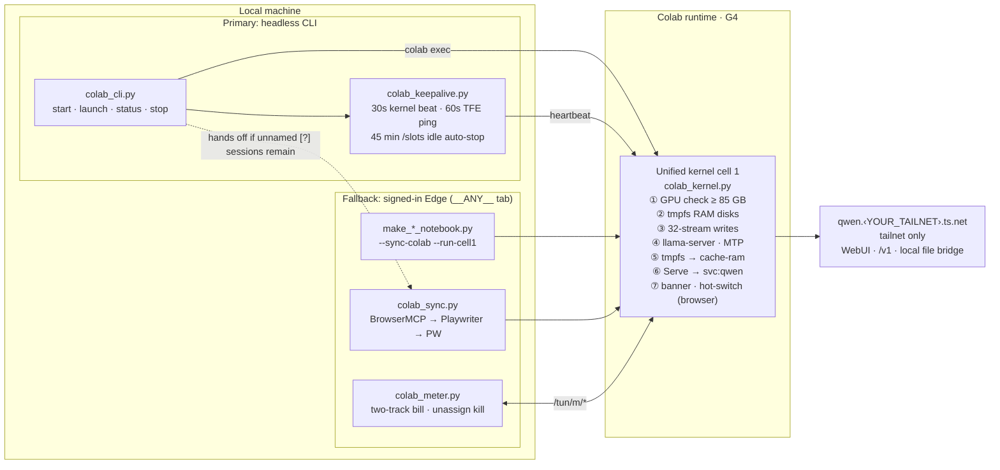

# colab-gpu-llm-service

[简体中文](README.md) | English

Run 100 GB-class GGUF models on a rented Google Colab G4 GPU (RTX PRO 6000 Blackwell, 96 GB VRAM): fast cold starts, headless keepalive, automatic release when idle, and a fixed private address over Tailscale.

The service is repeatable, private, and budget-aware. A single unified kernel (`scripts/colab_kernel.py`) powers **two coexisting tracks**:

- **Primary track (Headless Colab CLI + 30 s kernel heartbeat)** — `colab_cli.py` + `colab_keepalive.py` allocate a G4, run the kernel's startup code without opening a browser tab, keep the VM alive past Colab's 21–35 min CLI prune window via a 30 s `colab exec` heartbeat (ported from Wakeloom's local mode), and auto-stop after 45 idle minutes.
- **Fallback track (Browser notebook sync + zero-OAuth `/tun/m` meter & kill switch)** — `make_*_notebook.py --sync-colab --run-cell1`, `colab_sync.py` and `colab_meter.py` drive the same notebook inside a signed-in Edge tab (`BrowserMCP → Playwriter → playwright-cli`), provide an interactive WebUI/LoRA/hot-switch console, run archived multi-model notebooks, reconcile two-track CU bills, and force-kill unnamed `[?]` ghost sessions when `colab_cli.py stop --all` hands off to it.

The runtime is disposable and `/content` is wiped on every new session, so everything below is designed around fast, deterministic cold starts and around never paying for a GPU you are not using.

## What is in the box

| Piece | Problem it solves |
|---|---|
| **Primary:** Headless Colab CLI + 30 s kernel heartbeat (`colab_cli.py`, `colab_keepalive.py`) | Starts/stops G4 from the terminal with no browser tab; a 30 s `colab exec` heartbeat prevents CLI 0.7.5's 21–35 min idle reclamation, paired with a 45-min `/slots` idle auto-stop |
| Production fast-boot kernel & post-load `tmpfs` reclamation (`colab_kernel.py`) | `DEBUG_VERIFY = False` skips startup probes, polls `/health` every 0.5 s, warms up in the background, and frees GPU-only `/dev/shm` shard copies after load to grow `--cache-ram` to 16–64 GiB |
| DDR5 `tmpfs` RAM disk with 32-way direct writes | Colab's persistent disk caps writes at roughly 200-350 MiB/s; a 95 GB model would take minutes longer than it needs to |
| `MAP_POPULATE` zero-copy mapping of the PLE table | Removes a second memory copy and page faults during inference |
| `llama.cpp` MTP speculative decoding | Draft-head speculation tuned for code, tool calls and long-form writing |
| Tailscale Service (`svc:qwen`) + optional local MCP file bridge (`local_novel_mcp.py`) | A fixed `qwen.<YOUR_TAILNET>.ts.net` address that survives runtime changes, plus a reverse SOCKS5 bridge so the WebUI can read/write a local folder without prompts |
| **Fallback:** Browser-tab sync, zero-OAuth CU metering & ghost-session kill switch (`colab_sync.py`, `colab_meter.py`) | Pushes/runs notebooks in a signed-in browser tab, reads live balance/burn rate without OAuth, prints a two-track CU bill, and kills orphaned `[?]` sessions whose page was closed |
| Optional companion [Colab-yoga](https://github.com/incredible404-rgb/Colab-yoga) tray app (`colab_cli.py yoga`) | Shares the same G4 with this repo; `colab_kernel.py` exports the active models' headless cell 1 as its `colab_kernel_runners.json` |
| `.secrets.json` + `--sanitized` | Notebooks are generated from a private config; a sanitized build contains no real credential, tailnet or Drive ID |

## Architecture



## Fast cold start

1. **Skip the persistent-disk write wall.** The notebook grows `/dev/shm` and `/var/colab` and symlinks them back to the runtime directory. Weights land in physical RAM, so there is no disk I/O on the hot path.
2. **32 concurrent streams.** A separate downloader runs 8 processes x 4 threads, each writing with `os.pwrite` at its own offset. Separate processes avoid the single-process GIL and TLS decryption bottleneck. Signed CDN links are resolved once and reused.
3. **`MAP_POPULATE` for the largest tensor.** The second shard is a single 26.8 GiB per-layer embedding table. It is written to `/dev/shm` first and `llama-server` maps it with `--lazy-mode off`, pre-populating the page tables. Inference then runs without page faults and without a second copy.
4. **One-cell console.** After startup the first cell shows a ready banner with the WebUI link and a stop button that releases the GPU.

## Speculative decoding and sampling

`llama.cpp` runs `--spec-type draft-mtp` with a matching MTP draft head. The G4 notebook is tuned for code and long-horizon agent work: single 262,144-token slot, each model card's recommended sampling (no extra penalties or DRY), a 16 GiB prompt cache with slot persistence, and a 65,536-token output limit. Treat the exact numbers as a starting point and re-measure with your own prompts: run one cold request and two consecutive ones, and read `predicted_per_second` and the draft acceptance rate from the server log.

## Private access with Tailscale Service

The runtime joins your tailnet with a one-shot, ephemeral, `tag:colab` auth key minted from an OAuth client, then advertises `svc:qwen`. With `autoApprovers.services` in the ACL, no one has to log in or click Approve. The address stays `qwen.<YOUR_TAILNET>.ts.net` across runtimes. See [`references/tailscale-serve.md`](references/tailscale-serve.md) for the ACL snippet and the two classic failure modes (an interrupted cell kills the daemon; a missing `--statedir` breaks HTTPS).

The service is only visible inside your tailnet, so the WebUI works without pasting a key. If you ever expose it through Funnel or any public endpoint, add `--api-key-file` first.

## Primary track: Headless start with the official Colab CLI + 30 s kernel heartbeat

As of CLI 0.7.5, a CLI-created runtime (T4 or G4) is reclaimed 21-35 minutes after creation unless the kernel sees fresh executions; TFE pings, one long-running cell and ongoing inference do not count, and the legacy `RuntimeService/KeepAliveAssignment` RPC returns `403 USER_PROJECT_DENIED`. A one-line `colab exec` every 30 s keeps the VM alive (the pattern Wakeloom's local mode uses). `colab_keepalive.py` runs that execution itself the same way (a fresh kernel websocket per beat: connect, execute, close) instead of starting a CLI process every 30 s; an in-process failure is covered at once by a `colab exec` beat, and `COLAB_KEEPALIVE_BEAT=exec` reverts entirely. Tested 2026-11-10 on a CPU runtime: 37 min, 75 in-process beats, 0 failures, never reclaimed; the daemon averaged about 76 ms of CPU per beat (the CLI beat took about 1.1 s). Tested 2026-11-07 (`debug-runs/2026-11-07-*kernel-beat*`): the T4 control arm was pruned at 21.0 min while the heartbeat arm lived the full 42 min; a G4 running `qwen38-fn` served requests and lived 39 min across 77 heartbeats (1 expected queue timeout while cell 1 was running, 0 post-startup failures) until the idle guard stopped it cleanly.

`scripts/colab_cli.py` drives the official [`google-colab-cli`](https://github.com/googlecolab/google-colab-cli) (`uv tool install "google-colab-cli==0.7.5"`, authorize once with `colab sessions`). It runs the exact same cell-1 code generated by `colab_kernel.py` (any active or archived model listed by `colab_kernel.py --list`) with the frontend-only tail (banner, WebUI popup, stop button) stripped off. No browser tab is needed.

CLI 0.7 dropped its keep-alive daemon. `start` and `launch` spawn `scripts/colab_keepalive.py` detached under the CLI's own interpreter: it runs the kernel heartbeat every 30 s, also pings `GET /tun/m/<endpoint>/keep-alive/` (header `X-Colab-Tunnel: Google`) every 60 s, polls `/slots` over Tailscale and runs `colab stop` after `--idle-min` (default 45) minutes without inference. If the PC sleeps, the heartbeat stops and Colab reclaims the VM on its own within ~20 min.

```bash
python scripts/colab_cli.py start  [<slug>]    # G4 session -> cell 1 -> Tailscale /v1/models check -> verify cell
python scripts/colab_cli.py launch [<slug>]    # detached cell-1 launch (LAUNCH_DETACHED=1) -> poll /health
python scripts/colab_cli.py status                # balance, burn rate, sessions, heartbeat & idle-guard state
python scripts/colab_cli.py stop   --all          # release all + auto-fallback to colab_sync --release-all if needed
```

- **Model slugs:** active `qwen38-huihui-v2` (default), `gemma4-31b`, `qwen38-27b-rvn`, `glm53-flash`; archived ones such as `qwen38-fn` and `qwen38-fn-nl` start by slug too. `python scripts/colab_kernel.py --list` is the source of truth.
- **Automatic fallback on stop:** If `colab sessions` shows an unnamed `[?]` assignment (for example, a session started from a browser tab or an orphaned CLI assignment), `colab_cli.py stop --all` automatically invokes `colab_sync.py --release-all` from the fallback track to force-release it via `/tun/m/unassign` and verify `0 active / 0.00 CU/h`.
- CLI sessions cannot read Colab Secrets or mount Drive; the kernel downloads from pinned Hugging Face revisions and forwards a local `HF_TOKEN` when present. G4 rejects `--high-mem`, and `colab exec` times out after 30 s unless `--timeout` is passed; the script handles both.

## Fallback track: Browser-tab sync, zero-OAuth CU metering and ghost-session kill

Keep the browser workflow as a ready backup when:
1. You want the interactive cell-1 console (one-click LoRA toggle, stop button) or cell-2 **in-runtime hot switch** without releasing the G4 VM;
2. You are running the frozen multi-model notebooks (`qwen3.5-122b`, `nemotron-120b`, archived under `archive/multi-model-kernel/`) or the experimental Strata notebook;
3. The CLI OAuth token is expired/unconfigured and you want zero-OAuth operation inside an already signed-in Edge tab (`BrowserMCP → Playwriter → playwright-cli`);
4. You need the two-track CU bill or need to sweep `[?]` ghost sessions that the CLI cannot address by name.

Colab's own web app talks to `/tun/m/*`. The scripts call those endpoints from inside a signed-in `colab.research.google.com` tab, so no OAuth client or API key is needed.

```bash
python scripts/colab_meter.py status
# Active assignments: 0 | Burn rate: 0.00 CU/h | Balance: 988.85 CU | Eligible GPUs: H100, G4, A100, L4, T4

python scripts/colab_meter.py start -s g4 -g G4     # record opening balance and time
python scripts/colab_meter.py stop  -s g4           # kill, verify, print the two-track bill
python scripts/colab_meter.py stop  --all           # clear every active assignment

python scripts/colab_sync.py --status               # same read, no meter state needed
python scripts/colab_sync.py --release-all          # kill all and verify
```

**Tab hygiene.** With drive id `__ANY__`, an already open Colab tab is reused untouched (never reloaded or navigated). If none is open, a temporary tab is opened in the background and closed immediately after the call.

**Kill handshake.** For each active `endpoint`: `GET /tun/m/unassign/<endpoint>` returns a `token`; `POST` to the same URL with `X-Goog-Colab-Token: <token>` releases it. After 1.5 s the script re-queries `ccu-info` and `assignments`, up to 3 times, until `assignmentsCount == 0` and `consumptionRateHourly == 0`. This also clears ghost sessions whose notebook page was closed before `runtime.unassign()` could run.

**Two-track bill.**

```text
track 1 (account ledger delta)  max(0, start_balance - end_balance)
track 2 (wall clock)            duration_seconds / 3600 x rate_hourly
```

Track 1 is an account-wide balance delta: it lags a few minutes behind real consumption, includes every instance that ran in the window, and can even rise on a top-up or refund (it is clamped to 0 and a note is printed). Track 2 is per session. Showing both makes a stuck session obvious; with concurrent instances read track 2 as the per-session figure.

**Safe stop.** `colab_meter.py stop -s NAME` only releases the endpoints recorded for that session. An unknown name, or a session without bound endpoints, exits with 1 and releases nothing; use `--all` to force-release every active instance. A session recorded by `--run-cell1` while the VM was still allocating (rate 0, no endpoints) is backfilled with the real endpoint and burn rate by the next `status` or `stop`.

**Sync integration.** `make_*_notebook.py --sync-colab --run-cell1` records the opening balance once cell 1 starts. `--release-runtime` also calls `unassignCurrentVm`, sweeps leftover assignments, verifies `0 active / 0.00 CU/h` and prints the bill.

The `/tun/m` endpoints are undocumented and may change. Treat them as a convenience, and keep the Colab "Manage sessions" page as the ground truth if the two ever disagree.

## Quick start

### Prerequisites

| Item | Requirement |
|---|---|
| Paid Colab quota | A Colab Pro / Pro+ / Ultra plan or pay-as-you-go compute units (CU), with G4 selectable on the account; the free tier does not work. Rates and quotas change, see [`references/cu-budget.md`](references/cu-budget.md) |
| Host | Windows 10/11, Python 3.10+, Git; `pip install requests` (everything else is standard library). Scripts use scheduled tasks and `taskkill` to clean up keep-alive processes; macOS/Linux is untested |
| Official Colab CLI | `uv tool install "google-colab-cli==0.7.5"`, then run `colab sessions` once to authorize via OAuth. The keep-alive design follows 0.7.5's reclamation behavior, so pin this version |
| Tailscale | Local client >= 1.78, signed in; the `svc:qwen` Service, the `tag:colab` tag and an OAuth client created in your tailnet, see [`references/tailscale-serve.md`](references/tailscale-serve.md) |
| Optional: Colab-yoga | The companion Windows tray app ([Colab-yoga](https://github.com/incredible404-rgb/Colab-yoga)) installed to `%LOCALAPPDATA%\Programs\Colab-yoga`; it shares the same G4 with this repo. No core command depends on it |
| Optional: fallback track | Node.js and an Edge signed in to Google with the BrowserMCP extension (Playwriter or `@playwright/cli` as fallbacks) |

### From clone to first boot

```bash
git clone https://github.com/incredible404-rgb/colab-gpu-llm-service.git
cd colab-gpu-llm-service
pip install requests
cp .secrets.example.json .secrets.json          # fill in per the table below; the file is git-ignored

python scripts/colab_kernel.py --list           # active/archived model slugs; start without a slug uses the first active one
python scripts/colab_cli.py status              # read-only check: CLI authorized, CU balance readable, no GPU allocated
python scripts/colab_cli.py start               # G4 session -> cell 1 -> Tailscale /v1/models check -> verify cell
python scripts/colab_cli.py stop --all          # release right after use; check the last line shows 0 active / 0.00 CU/h
```

A successful `start` prints `[colab_cli] start OK in <seconds>s`; afterwards `http://qwen.<YOUR_TAILNET>.ts.net:443/v1` is the OpenAI-compatible endpoint (Bearer key is `api_key` from `.secrets.json`) and the root path is the WebUI, both visible only inside your tailnet.

### `.secrets.json` fields

The first four are required by `start`; a missing one fails fast with `missing ... in .secrets.json / environment`.

| Field | Meaning |
|---|---|
| `api_key` | Any long random string you choose; written to the runtime's llama-server as the Bearer key and used by you to call `/v1` |
| `ts_client_id`, `ts_client_secret` | Tailscale OAuth client credentials (Auth Keys: Write only, tag `tag:colab`) used to mint one-shot ephemeral auth keys at runtime |
| `tailnet_fqdn` | Service address, `qwen.<YOUR_TAILNET>.ts.net` (`qwen` is the Service name you created) |
| `local_tailscale_ip` | Optional. Tailscale IP of the machine running `local_novel_mcp.py` (the WebUI file bridge) |
| `*_drive_id` (one per active model) | Optional. Drive file ID of that model's notebook, needed only for `--sync-colab`; `colab_kernel.py` resolves and writes it back from the local Drive client database when generating |

Each field can also come from an environment variable: `LLAMA_API_KEY`, `TS_CLIENT_ID`, `TS_CLIENT_SECRET`, `TAILNET_FQDN`, `LOCAL_TAILSCALE_IP`, plus `G4HUIHUI_DRIVE_ID`, `GEMMA31B_DRIVE_ID`, `RVN27B_DRIVE_ID`, `GLM53_DRIVE_ID`. Resolution order is `.secrets.json`, then environment, then a placeholder. Other tunables:

| Variable | Effect |
|---|---|
| `COLAB_YOGA_DIR` | Colab-yoga install directory (default `%LOCALAPPDATA%\Programs\Colab-yoga`) |
| `COLAB_NOTEBOOKS_DIR` | Drive "Colab Notebooks" folder that generated notebooks are mirrored into; when unset, `My Drive` roots on each drive letter are probed and nothing is mirrored if none is found |
| `DRIVEFS_DB` | Path of the Drive client metadata database |
| `NOVEL_ROOT` | Local directory `local_novel_mcp.py` exposes to the WebUI |
| `HF_TOKEN` | Hugging Face token forwarded to the runtime (gated or rate-limited models) |
| `COLAB_KEEPALIVE_BEAT` | `exec` makes each heartbeat start `colab exec` again (default: run in the daemon, falling back on failure) |

### Command cheat sheet

```bash
python scripts/colab_cli.py start  [<slug>] [--gpu G4] [--idle-min 45] [--no-verify] [--keep-on-fail]
python scripts/colab_cli.py launch [<slug>]       # detached start (reads the private build in notebooks/; generate it first with colab_kernel.py <slug>)
python scripts/colab_cli.py verify [<slug>]       # rerun the verify cell only
python scripts/colab_cli.py status                # balance, burn rate, sessions, heartbeat & idle-guard state
python scripts/colab_cli.py stop [<slug> | --all] # release; falls back to colab_sync --release-all for unnamed [?] sessions
python scripts/colab_cli.py yoga [gui | wake | status | stop]   # optional Colab-yoga interop (old name easycolab still works)

python scripts/colab_kernel.py --list             # active and archived models
python scripts/colab_kernel.py --probe-hf <repo> [rev]   # HF pre-flight for a new model
python scripts/colab_meter.py status              # fallback track: cloud ledger + current assignments
python scripts/colab_meter.py stop --all          # fallback track: kill and print the two-track bill

cd scripts && python -X utf8 -m unittest discover -p "test_*.py"   # all unit tests
```

Fallback track (browser sync): `python scripts/make_g4_huihui_v2_notebook.py --sync-colab --run-cell1`, then `python scripts/colab_meter.py stop --all` to release and settle.

### Optional: Colab-yoga tray app

[Colab-yoga](https://github.com/incredible404-rgb/Colab-yoga) is the companion Windows tray manager, installed to `%LOCALAPPDATA%\Programs\Colab-yoga` (`Colab-yoga.exe`, `runtime\python.exe`, `bridge\colab_yoga_bridge.py`). When `colab_kernel.py` generates notebooks it exports the headless cell 1 of every active model to `colab_kernel_runners.json` in that directory (skipped with a hint if the directory does not exist); `colab_cli.py yoga ...` reports the expected install location when it cannot find the app, and `COLAB_YOGA_DIR` points it at a custom directory. Running `colab_cli.py start` first and waking Colab-yoga afterwards, or the other way round, reuses the same G4 through `~/.config/colab-cli/sessions.json`.

### Troubleshooting

| Symptom | Fix |
|---|---|
| `missing ... in .secrets.json / environment` | The four required fields are still placeholders; fill them in per the table above |
| `colab` not found, or it asks for authorization | `uv tool install "google-colab-cli==0.7.5"`, then run `colab sessions` once |
| `Colab-yoga not found at ...` | The optional component is not installed: install Colab-yoga as the message says, or set `COLAB_YOGA_DIR`; core commands are unaffected |
| `Backend rejected accelerator` | G4 has a single shape, so `--high-mem` is rejected (the script skips it); or the account has no G4 quota or no free card right now |
| Instance vanishes after 20-35 minutes | The heartbeat process is not running (PC slept or it was killed); check with `status`, `start`/`launch` is what spawns it |
| Still active or `[?]` after `stop --all` | `python scripts/colab_sync.py --release-all` (needs an Edge tab signed in to Google), then verify with `colab_meter.py status` |
| Domain times out | A fresh Service approval takes a few to ten-odd seconds, retry; confirm Tailscale >= 1.78 and `autoApprovers.services` in the ACL |

The full runbook, including how to onboard a model, is in [`SKILL.md`](SKILL.md) section 7 onward.

The notebooks committed to the public repository under `notebooks/` are **sanitized builds** (placeholders only). Running `make_*_notebook.py` locally writes your private build to `notebooks/*.ipynb` (same file name as the committed sanitized one); before pushing to a public remote, always regenerate into the staging tree with `--sanitized --output-dir`, and check `git status` to make sure no private build is staged.

### Sanitized builds

```bash
python scripts/make_g4_huihui_v2_notebook.py --sanitized --output-dir dist/
```

`--sanitized` fills every sensitive field with a placeholder and ignores `.secrets.json` and the environment. It refuses to combine with `--sync-colab`, so a placeholder notebook can never be pushed to Colab.

## Repository layout

| Path | Purpose |
|---|---|
| `SKILL.md` | agent-facing runbook (prerequisites, first boot, cheat sheet, troubleshooting; CLI primary + browser fallback) |
| `scripts/colab_kernel.py` | unified G4 kernel & distributor (active `MODELS`: `qwen38-huihui-v2`, `gemma4-31b`, `qwen38-27b-rvn`, `glm53-flash`); also exports Colab-yoga's `colab_kernel_runners.json` |
| `scripts/archived_models.py` | archived model declarations (`ARCHIVED_MODELS`); they share the latest kernel and start by slug |
| `scripts/colab_cli.py` | PRIMARY: headless Colab CLI launcher, status & stop (falls back to colab_sync), includes the `yoga` subcommand |
| `scripts/colab_keepalive.py` | PRIMARY: detached 30s kernel heartbeat + 60s TFE ping + 45m /slots idle guard |
| `scripts/make_g4_huihui_v2_notebook.py`, `make_31b_gemma4_notebook.py`, `make_27b_rvn_notebook.py`, `make_glm53_flash_notebook.py` | notebook generator entries for the active models (7-line wrappers) |
| `scripts/make_g4_fn_notebook.py`, `make_g4_fn_nl_notebook.py` | generator entries for the archived `qwen38-fn` / `qwen38-fn-nl` |
| `scripts/make_strata_fn_notebook.py` | experimental Strata engine (Unsloth UD-IQ4_XS-v31 + DFlash2) notebook generator |
| `scripts/boot_strata_trial.py` | experimental detached CLI boot helper for the Strata notebook |
| `scripts/bench_ab.py` | A/B benchmark against a running service (decode / recall / tools / compare) |
| `scripts/colab_sync.py` | FALLBACK: push/run cells in Colab Web (BrowserMCP→Playwriter→PW), /tun/m release |
| `scripts/colab_meter.py` | FALLBACK: zero-OAuth status / start / stop CLI with two-track CU bill |
| `scripts/colab_pw.mjs` | Playwriter fallback backend (supports the __ANY__ tab mode) |
| `scripts/local_novel_mcp.py` | local Windows directory MCP server bridged into the Colab WebUI |
| `scripts/secrets_config.py` | .secrets.json / env / placeholder loader |
| `scripts/parallel_download.py` | multi-process downloader reference |
| `scripts/webui_console.py` | first-cell console and stop button |
| `scripts/stop-runtime.py` | release helper |
| `scripts/update-pi-provider.ps1` | register the endpoint in a local pi provider list |
| `scripts/test_*.py` | unit tests: keep-alive and CLI, kernel and boot fingerprint, Colab-yoga interop, local MCP, metering, benchmark |
| `references/` | per-model notes, CU budget, Tailscale and remote-access guides |
| `archive/multi-model-kernel/` | frozen multi-model kernel, generators and notes (122B, Nemotron, Gemma) |
| `debug-runs/` | 2026-11-07 T4 control/heartbeat A/B and G4 soak logs |
| `notebooks/` | sanitized generated notebooks |
| `.secrets.example.json` | config template |

## Security notes

- `.secrets.json` and `.colab-meter-state.json` are listed in `.gitignore`. Verify with `git status` before the first push.
- Generated notebooks embed the API key and Tailscale OAuth secret, because the runtime needs them. Never commit or share a notebook built without `--sanitized`.
- Use an OAuth client scoped to auth-key creation with `tag:colab` only, and rotate it if a non-sanitized notebook ever leaves your machine.
- A tailnet-only service relies on WireGuard identity for isolation. Public exposure needs an application-layer API key.

## License

MIT. See [`LICENSE`](LICENSE). Model weights keep their own licenses; check each model card before use.
