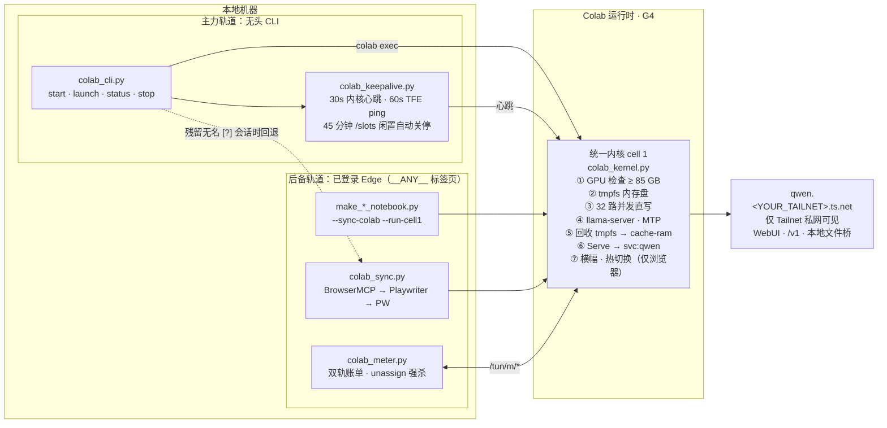

# colab-gpu-llm-service

中文 | [English](README.en.md)

在 Google Colab 租用的 G4 GPU（RTX PRO 6000 Blackwell，96 GB 显存）上跑百 GB 级 GGUF 大模型：冷启动快，无头保活，闲置自动释放，经 Tailscale 私网固定地址访问。

整套服务可复现、私有、花费可控。单一统一内核（`scripts/colab_kernel.py`）同时驱动**两条并存轨道**：

- **主力轨道（无头 Colab CLI + 30 秒内核心跳）** — `colab_cli.py` + `colab_keepalive.py` 无需打开浏览器标签页即可分配 G4 并运行内核启动代码，通过每 30 秒一次的 `colab exec` 内核心跳（移植自 Wakeloom 本地模式）跨过 Colab CLI 的 21–35 分钟闲置回收窗口，并在连续闲置 45 分钟后自动释放实例。
- **后备轨道（浏览器 Notebook 同步 + 零 OAuth `/tun/m` 算力计费与强杀开关）** — `make_*_notebook.py --sync-colab --run-cell1`、`colab_sync.py` 与 `colab_meter.py` 在已登录的 Edge 标签页内（`BrowserMCP → Playwriter → playwright-cli`）驱动同一份 Notebook，提供交互式 WebUI / LoRA / 模型热切换控制台、运行归档的多模型 Notebook、核对双轨 CU 账单，并在 `colab_cli.py stop --all` 移交时强制清理无名 `[?]` 幽灵会话。

Colab 运行时是一次性的，每次新会话都会清空 `/content`，因此下文的全部设计都围绕两件事展开：**快速、确定性的冷启动**，以及**绝不为没在使用的 GPU 付一分钱**。

## 核心组件一览

| 组件 | 解决的问题 |
|---|---|
| **主力轨道：** 无头 Colab CLI + 30 秒内核心跳（`colab_cli.py`、`colab_keepalive.py`） | 在终端直接启停 G4，无需打开浏览器标签页；30 秒 `colab exec` 心跳防止 CLI 0.7.5 的 21–35 分钟闲置回收，配合 45 分钟 `/slots` 无推理自动关停 |
| 生产级极速启动内核与加载后 `tmpfs` 内存回收（`colab_kernel.py`） | `DEBUG_VERIFY = False` 跳过启动探针，每 0.5 秒轮询 `/health`，后台异步预热，并在加载完成后释放仅驻留 GPU 的 `/dev/shm` 分片副本，将 `--cache-ram` 扩大至 16–64 GiB |
| DDR5 `tmpfs` 内存盘 + 32 路并发直写 | Colab 持久盘写入上限约 200–350 MiB/s；写一个 95 GB 的模型会平白多花好几分钟 |
| PLE 嵌入表 `MAP_POPULATE` 零拷贝映射 | 消除推理期间的二次内存拷贝与缺页中断（page fault） |
| `llama.cpp` MTP 投机解码 | 针对代码、工具调用与长文写作调优的 MTP 草稿头投机解码 |
| Tailscale Service（`svc:qwen`）+ 可选本机 MCP 文件桥（`local_novel_mcp.py`） | 跨运行时固定不变的 `qwen.<YOUR_TAILNET>.ts.net` 入口地址，搭配反向 SOCKS5 桥让 WebUI 无需弹窗确认即可读写本地目录 |
| **后备轨道：** 浏览器标签页同步、零 OAuth CU 计费与幽灵会话强杀（`colab_sync.py`、`colab_meter.py`） | 在已登录浏览器标签页推送/运行 Notebook、免 OAuth 读取实时余额与燃烧率、打印双轨 CU 账单，并强杀关掉页面后残留的无名 `[?]` 会话 |
| `.secrets.json` + `--sanitized` | Notebook 由私有配置生成；脱敏构建（sanitized build）不含任何真实密钥、Tailnet 名称或 Google Drive 文件 ID |

## 架构全景



## 极速冷启动

1. **绕开持久盘写入瓶颈。** Notebook 先扩容 `/dev/shm` 与 `/var/colab`，再通过软链接映射回运行时目录。模型权重直接落入物理 DDR5 内存，热路径上零磁盘 I/O。
2. **32 路并发流下载。** 独立下载器启动 8 进程 × 4 线程，每个线程用 `os.pwrite` 按各自偏移量直接写入文件。多进程架构避开了单进程 Python GIL 与 TLS 解密瓶颈；签名 CDN 链接只解析一次并跨工作进程复用。
3. **最大张量采用 `MAP_POPULATE` 预填充。** 第二分片是单块 26.8 GiB 的逐层嵌入表（PLE table），优先写入 `/dev/shm` 并由 `llama-server` 以 `--lazy-mode off` 映射、预先填充页表，推理时既无缺页中断也无二次拷贝。
4. **单单元格控制台。** 启动完成后，第一个单元格直接展示就绪横幅、WebUI 入口链接以及一键释放 GPU 的停止按钮。

## 投机解码与采样参数

`llama.cpp` 以 `--spec-type draft-mtp` 配合对应的 MTP 草稿头运行。G4 Notebook 专为代码与长程 Agent 任务调优：单槽 262,144 token 上下文、严格采用模型卡推荐采样参数（不额外加惩罚项或 DRY）、16 GiB 提示词缓存（支持槽位持久化）以及 65,536 token 最大输出上限。具体吞吐可按自己的提示词实测：先发一次冷请求、再连发两次热请求，从服务端日志读取 `predicted_per_second` 与草稿接受率。

## Tailscale Service 私网固定入口

运行时使用由 OAuth 客户端动态签发的单次、临时（ephemeral）、带 `tag:colab` 标签的认证密钥加入你的 Tailnet，并发布 `svc:qwen` 服务。在 Tailscale ACL 中配置 `autoApprovers.services` 后，全程无需人工登录或点击批准，跨运行时的访问地址始终固定为 `qwen.<YOUR_TAILNET>.ts.net`。ACL 配置片段与两种常见故障模式（中断单元格杀掉守护进程、漏传 `--statedir` 导致 HTTPS 失效）见 [`references/tailscale-serve.md`](references/tailscale-serve.md)。

该服务仅在你的 Tailnet 私网内可见，因此打开 WebUI 无需粘贴 API Key。若你需要通过 Funnel 或任何公网入口暴露服务，请务必先加上 `--api-key-file`。

## 主力轨道：官方 Colab CLI 无头启动 + 30 秒内核心跳

自 CLI 0.7.5 起，由 CLI 创建的运行时（无论是 T4 还是 G4）若内核没有收到新的代码执行请求，会在创建后 21–35 分钟内被强制回收；单纯的 TFE ping、单个长跑单元格或正在进行的模型推理都不算数，且旧版 `RuntimeService/KeepAliveAssignment` RPC 会返回 `403 USER_PROJECT_DENIED`。每隔 30 秒执行一行轻量 `colab exec` 即可让 VM 持续存活（与 Wakeloom 本地模式同理）。2026-11-07 实测（见 `debug-runs/2026-11-07-*kernel-beat*`）：T4 对照组在 21.0 分钟被回收，而心跳组完整存活满 42 分钟；运行 `qwen38-fn` 的 G4 实例在 77 次心跳间持续对外服务满 39 分钟（仅在 Cell 1 启动期间出现 1 次预期的队列超时，启动完成后 0 失败），直至闲置守卫干净地将其关停。

`scripts/colab_cli.py` 封装并驱动官方 [`google-colab-cli`](https://github.com/googlecolab/google-colab-cli)（通过 `uv tool install google-colab-cli` 安装，首次使用运行 `colab sessions` 完成一次授权）。它执行由 `colab_kernel.py` 生成的完全相同的 Cell 1 代码（支持 `qwen38-fn` IQ4_XS-plus 或 `qwen38-fn-nl` IQ4_NL），仅剥离了纯前端尾部（横幅、WebUI 弹窗、停止按钮），全程无需打开浏览器标签页。

CLI 0.7 移除了自带的保活守护进程。`start` 与 `launch` 会使用 CLI 自身的 Python 解释器在后台独立拉起 `scripts/colab_keepalive.py`：每 30 秒发送一次内核心跳，每 60 秒请求一次 `GET /tun/m/<endpoint>/keep-alive/`（带 `X-Colab-Tunnel: Google` 头），同时通过 Tailscale 轮询 `/slots`，在连续 `--idle-min`（默认 45）分钟无推理活动后自动执行 `colab stop`。若本地电脑休眠，心跳随之停止，Colab 会在约 20 分钟内自动回收 VM。

```bash
python scripts/colab_cli.py start  qwen38-fn      # 分配 G4 -> 跑 cell 1 -> 检查 Tailscale /v1/models -> 跑验证 cell
python scripts/colab_cli.py launch qwen38-fn      # 后台分离启动 cell 1 (LAUNCH_DETACHED=1) -> 轮询 /health
python scripts/colab_cli.py status                # 查看余额、燃烧率、活动会话、心跳与闲置守卫状态
python scripts/colab_cli.py stop   --all          # 释放全部实例；若残留无名会话则自动回退调用 colab_sync --release-all
```

- **已注册模型代号（slug）：** `qwen38-fn`（`Swift-1.5-Qwen3.8-Flash-Next-IQ4_XS`）与 `qwen38-fn-nl`（`Swift-1.5-Qwen3.8-Flash-Next-IQ4_NL`）。
- **停止时自动回退：** 若 `colab sessions` 显示存在无名 `[?]` 分配（例如从浏览器标签页启动的会话或孤立的 CLI 会话），`colab_cli.py stop --all` 会自动调用后备轨道的 `colab_sync.py --release-all`，通过 `/tun/m/unassign` 强制释放并核验 `0 active / 0.00 CU/h`。
- CLI 会话无法读取 Colab Secrets 或挂载 Google Drive；内核直接从锁定的 Hugging Face commit 下载权重，并在本地存在 `HF_TOKEN` 时自动转发。此外 G4 不接受 `--high-mem` 参数，且 `colab exec` 默认 30 秒超时（需显式传 `--timeout`），脚本已内置处理这两项细节。

## 后备轨道：浏览器标签页同步、零 OAuth CU 计费与幽灵会话强杀

在以下场景下，可随时使用浏览器工作流作为后备：
1. 需要交互式 Cell 1 控制台（一键切换 LoRA、网页停止按钮）或 Cell 2 **不释放 G4 VM 的实例内模型热切换**；
2. 运行已归档冻结的多模型 Notebook（`qwen3.5-122b`、`nemotron-120b`、`gemma4-31b`，位于 `archive/multi-model-kernel/`）或实验性的 Strata Notebook；
3. CLI OAuth 令牌过期或未配置，希望直接在已登录的 Edge 标签页内（`BrowserMCP → Playwriter → playwright-cli`）零 OAuth 操作；
4. 需要打印双轨 CU 账单，或清扫 CLI 无法按名称寻址的 `[?]` 幽灵会话。

Colab 官方网页前端通过 `/tun/m/*` 接口通信。本轨道脚本直接在已登录的 `colab.research.google.com` 标签页上下文内调用这些接口，因此不需要额外的 OAuth 客户端或 API Key。

```bash
python scripts/colab_meter.py status
# Active assignments: 0 | Burn rate: 0.00 CU/h | Balance: 988.85 CU | Eligible GPUs: H100, G4, A100, L4, T4

python scripts/colab_meter.py start -s g4 -g G4     # 记录初始算力余额与启动时间
python scripts/colab_meter.py stop  -s g4           # 强杀实例、核验释放结果并打印双轨账单
python scripts/colab_meter.py stop  --all           # 清空所有活动分配

python scripts/colab_sync.py --status               # 同样的实时状态读取，无需本地计费状态文件
python scripts/colab_sync.py --release-all          # 强杀全部活动实例并核验
```

**标签页免打扰。** 使用虚拟 Drive ID `__ANY__` 时，若浏览器里已有打开的 Colab 标签页，脚本直接原位借用（绝不刷新或跳转页面）；若当前没有打开的 Colab 标签页，则在后台静默新建一个临时标签页，调用完成后立即关闭。

**强杀握手（Kill handshake）。** 对每个活动 `endpoint`：先请求 `GET /tun/m/unassign/<endpoint>` 获取 `token`，再带 `X-Goog-Colab-Token: <token>` 头向同一 URL 发送 `POST` 完成释放。等待 1.5 秒后重新查询 `ccu-info` 与 `assignments`（最多重试 3 次），直到确认 `assignmentsCount == 0` 且 `consumptionRateHourly == 0`。这能彻底清掉还没来得及执行 `runtime.unassign()` 就被关掉页面的幽灵会话。

**双轨账单（Two-track bill）。**

```text
轨道 1（账户总账差额）  max(0, start_balance - end_balance)
轨道 2（挂钟时长核算）  duration_seconds / 3600 x rate_hourly
```

轨道 1 是账户级余额差值：比实际消耗滞后几分钟，包含该时间窗内运行过的所有实例，遇到充值或退费甚至可能上升（此时脚本会截断为 0 并打印说明）。轨道 2 按单会话精确计时计费。同时展示两轨能让未释放的卡死会话一目了然；多实例并发时以轨道 2 作为单会话消耗为准。

**安全停止。** `colab_meter.py stop -s NAME` 只释放该会话名下记录的 endpoint；未知会话名或尚未绑定 endpoint 的会话会以退出码 1 安全退出、不误杀任何实例（需全清时显式用 `--all`）。若 `--run-cell1` 记录时尚处于 VM 分配中（费率为 0、无 endpoint），下一次运行 `status` 或 `stop` 时会自动回填真实 endpoint 与燃烧率。

**同步集成。** `make_*_notebook.py --sync-colab --run-cell1` 会在 Cell 1 启动后自动记录初始余额；`--release-runtime` 会依次调用 `unassignCurrentVm`、清扫残留分配、核验 `0 active / 0.00 CU/h` 并打印账单。

`/tun/m` 属于未公开内部接口，未来可能变动；日常作为便捷工具使用即可，若数据有出入以 Colab 网页的“管理会话（Manage sessions）”为准。

## 快速上手

环境要求：Python 3.10+、具备 G4 权限的 Colab Pro/Pro+/Ultra 订阅，以及配置好 OAuth 客户端的 Tailscale Tailnet。
- **主力轨道（无头 CLI）：** 运行 `uv tool install google-colab-cli` 安装官方 CLI，并通过 `colab sessions` 完成一次登录授权。
- **后备轨道（浏览器同步与计费）：** Node.js，以及已登录 Google 账号并安装 BrowserMCP 扩展的 Edge 浏览器（Playwriter 或 `@playwright/cli` 作为后备）。

```bash
git clone <this repo> && cd colab-gpu-llm-service
cp .secrets.example.json .secrets.json         # 填入你自己的配置；该文件已在 .gitignore 中忽略

# 1. 主力轨道：无头 CLI 启动 / 状态查询 / 停止（无需打开浏览器标签页）
python scripts/colab_cli.py start qwen38-fn    # 或: qwen38-fn-nl
python scripts/colab_cli.py status
python scripts/colab_cli.py stop --all

# 2. 后备轨道：生成 Notebook、推送到 Colab 网页并在 Edge 中运行 Cell 1
python scripts/make_g4_fn_notebook.py          # 生成 notebooks/qwen3.8-flash-next-g4-colab.ipynb
python scripts/make_g4_fn_notebook.py --sync-colab --run-cell1
python scripts/colab_meter.py stop --all       # 释放实例并打印双轨 CU 账单
```

`.secrets.json` 字段说明：

| 字段 | 含义 |
|---|---|
| `api_key` | 写入运行时的模型服务 API Key |
| `ts_client_id`, `ts_client_secret` | 用于动态签发临时认证密钥的 Tailscale OAuth 客户端凭据 |
| `tailnet_fqdn` | 服务访问域名，形如 `qwen.<YOUR_TAILNET>.ts.net` |
| `local_tailscale_ip` | 运行 `local_novel_mcp.py`（WebUI 本地文件桥）的 Windows 主机 Tailscale IP |
| `g4_drive_id`, `g4nl_drive_id` | Notebook 在 Google Drive 中的文件 ID（仅 `--sync-colab` 需要） |

每个字段也可通过同名环境变量传入：`LLAMA_API_KEY`、`TS_CLIENT_ID`、`TS_CLIENT_SECRET`、`TAILNET_FQDN`、`LOCAL_TAILSCALE_IP`、`G4_DRIVE_ID`、`G4NL_DRIVE_ID`。读取优先级依次为：`.secrets.json` → 环境变量 → 占位符。

公开仓库 `notebooks/` 目录下提交的均为**脱敏构建（sanitized builds）**，仅含占位符。在本地直接运行 `make_*_notebook.py` 会把带私有配置的 Notebook 写到 `notebooks/*.ipynb`；向公开远端推送前，请务必用 `--sanitized --output-dir` 重新生成脱敏副本。

### 生成脱敏构建

```bash
python scripts/make_g4_fn_notebook.py --sanitized --output-dir dist/
```

`--sanitized` 会将所有敏感字段替换为占位符，并忽略本地 `.secrets.json` 与环境变量；同时它禁止与 `--sync-colab` 混用，防止误把占位符 Notebook 推送到 Colab。

## 仓库目录结构

| 路径 | 作用 |
|---|---|
| `SKILL.md` | 面向 Agent 的操作手册（CLI 主力轨道 + 浏览器后备轨道双轨并存） |
| `scripts/colab_kernel.py` | 统一的 3.8fn G4 内核与分发器（qwen38-fn IQ4_XS-plus、qwen38-fn-nl IQ4_NL） |
| `scripts/colab_cli.py` | 主力轨道：无头 Colab CLI 启动、状态查询与停止（自动回退至 colab_sync） |
| `scripts/colab_keepalive.py` | 主力轨道：后台分离的 30s 内核心跳 + 60s TFE ping + 45m /slots 闲置守卫 |
| `scripts/make_g4_fn_notebook.py` | G4 IQ4_XS-plus Notebook 生成入口 |
| `scripts/make_g4_fn_nl_notebook.py` | G4 IQ4_NL（更高精度，约 87 GB 显存）Notebook 生成入口 |
| `scripts/make_strata_fn_notebook.py` | 实验性 Strata 引擎（Unsloth UD-IQ4_XS-v31 + DFlash2）Notebook 生成器 |
| `scripts/boot_strata_trial.py` | 实验性 Strata Notebook 的分离式 CLI 启动辅助脚本 |
| `scripts/colab_sync.py` | 后备轨道：Colab 网页推送与单元格执行（BrowserMCP→Playwriter→PW）及 /tun/m 释放 |
| `scripts/colab_meter.py` | 后备轨道：零 OAuth status / start / stop CLI 与双轨 CU 账单 |
| `scripts/colab_pw.mjs` | Playwriter 后备后端（支持 __ANY__ 标签页复用模式） |
| `scripts/local_novel_mcp.py` | 桥接进 Colab WebUI 的本地 Windows 小说目录 MCP 服务 |
| `scripts/secrets_config.py` | .secrets.json / 环境变量 / 占位符加载器 |
| `scripts/parallel_download.py` | 多进程并发下载器参考实现 |
| `scripts/webui_console.py` | 首单元格控制台与停止按钮 |
| `scripts/stop-runtime.py` | 运行时释放辅助脚本 |
| `scripts/update-pi-provider.ps1` | 将服务端点注册进本地 pi provider 列表 |
| `scripts/test_colab_keepalive.py` | 30s 内核心跳、TFE ping 与计划任务清理单元测试 |
| `scripts/test_colab_kernel.py` | 生产级极速启动内核与启动指纹单元测试 |
| `scripts/test_local_novel_mcp.py` | 本地小说 MCP 工具与防覆盖保护单元测试 |
| `references/` | 模型说明、CU 预算核算、Tailscale 与远程接入指南 |
| `archive/multi-model-kernel/` | 已归档冻结的多模型内核、生成器与说明（122B、Nemotron、Gemma） |
| `debug-runs/` | 2026-11-07 T4 对照/心跳 A/B 实验与 G4 长稳测试日志 |
| `notebooks/` | 脱敏后的生成版 Notebook |
| `.secrets.example.json` | 配置模板 |

## 安全说明

- `.secrets.json` 与 `.colab-meter-state.json` 已列入 `.gitignore`；首次推送前请用 `git status` 确认未被暂存。
- 本地生成的非脱敏 Notebook 内嵌了模型 API Key 与 Tailscale OAuth 密钥（供运行时读取），切勿提交或分享未加 `--sanitized` 生成的 Notebook。
- Tailscale OAuth 客户端权限应严格限制为仅签发带 `tag:colab` 的认证密钥；若非脱敏 Notebook 曾离开本机，请立即轮换密钥。
- 仅限 Tailnet 内部访问的服务依赖 WireGuard 身份完成隔离；若对公网暴露，必须额外启用应用层 API Key。

## 许可证

MIT，详见 [`LICENSE`](LICENSE)。各模型权重遵循其各自的许可证，使用前请查阅对应模型卡。
